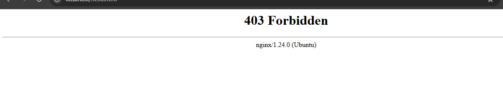
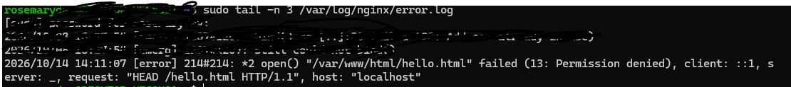
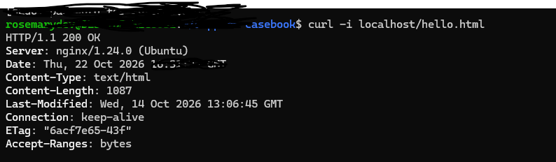

# Incident 02: Nginx Returns 403 Forbidden (File Permissions)

## Ticket Details

- **Ticket ID:** INC-002
- **Category:** Linux / Web Server Troubleshooting
- **Severity:** Medium
- **Status:** Resolved


## 1. Customer Report

Hi support team, I tried accessing your website and I got a page that says "403 forbidden". why is that??? Really frustrating!

Miya


## 2. Symptoms

403 Forbidden

Permission denied





## 3. Investigation and Diagnosis

Ran;

a.

```bash
ls -l /var/www/html/hello.html
```

output:

-rw------- 1 root root, so others have no access

b.

```bash
sudo tail -n 3 /var/log/nginx/error.log
```

output:

open() "var/www/html/hello.html" failed (13: permission denied)

c. I also matched the log line to the timestamp of the failure.





## 4. Root Cause

The file had permissions set to 600(-rw-------), meaning only its owner root, could read and write it.

I checked the Nginx processes using:

```bash
ps -eo user,comm | grep nginx
```

The output confirmed that the Nginx worker processes run as wwww-data. Because the workers could not read the file, Nginx logged a permission-denied error and returned 403 forbidden.

In this lab, I deliberately set the file permissions to 600 to reproduce the issue. In a production environment, I would investigate what changed by checking the file's modification time with stat and reviewing recent deployments. 


## 5. Resolution

I changed the file permission to 644:

```bash
sudo chmod 644 /var/www/html/hello.html
```

This allows the file owner to read and write the file while the group and others can read it. This gives Nginx worker the read access they need to serve the HTML page.


## 6. Verification

I tested the page using:

```bash
curl -i localhost/hello.html
```

Results: The server returned HTTP/1.1 200 ok and HTML page content was displayed. This confirmed that the permission issue was resolved.




## 7. Customer Reply

Hello Miya,

Sincere apologies for the inconvenience and thank you for reporting this issue. We identified a file permission setting that prevented the web server from reading the affected page. The permissions have been corrected and we've confirmed that the page is loading successfully again.

Thank you for your patience.

Best regards,

Technical Support


## 8. Prevention

a. Set files to permissions that allow the Nginx worker to read them, commonly 644 for static HTML files. 

b. Set parent directories so the Nginx worker can transverse them, commonly 755.

c. Avoid overly restrictive permissions and never use 777 as a quick fix.

d. Investigate the error log before changing permissions.


## 9. Lessons Learned
A 403 doesn't always mean a file permissions problem. The error log shows the real cause, so I checked it before fixing or changing anything.

In this case, the error log helped me identify it was a file issue, the type of file and why.


